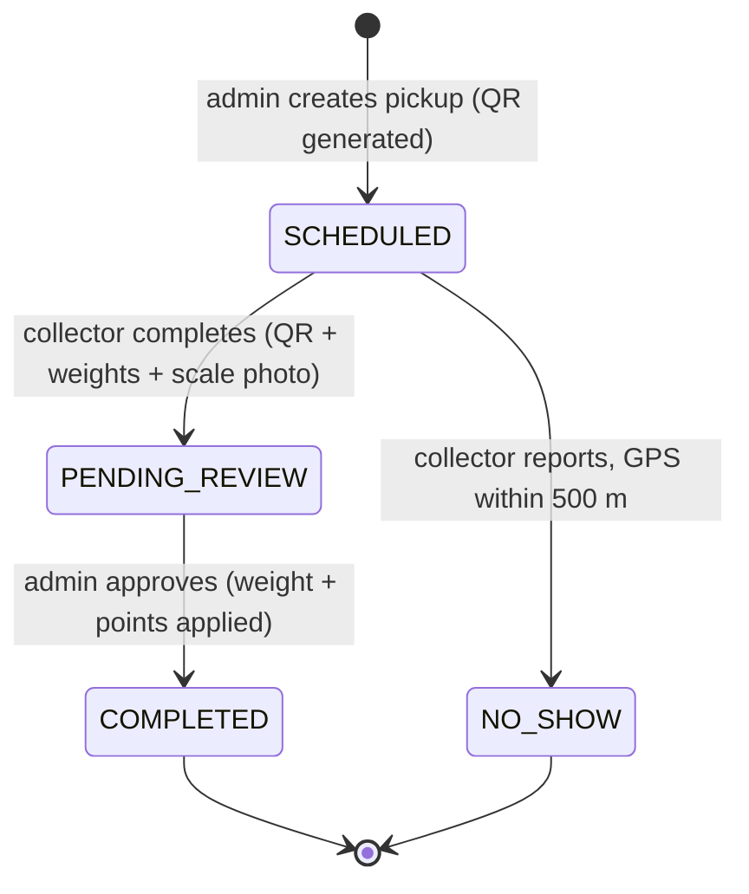

# 00 — أول User Journey وقواعد العمل ونطاق الـ MVP

> **Owner:** Seat 1 (Product Owner) · **مرتبط بـ:** Development → "تحديد أول User Journey"

## 1. الـ Journey الأولى: "من الزيارة إلى النقاط"

أقصر رحلة بتثبت إن المنتج بيشتغل من أول لآخر، وبتلمس الأدوار التلاتة وقاعدة البيانات والصلاحيات.

| # | من | الخطوة | النتيجة |
|---|---|---|---|
| 1 | الأدمن | يقبل المندوب بعد مراجعة مستنداته | `isApprovedByAdmin = true` |
| 2 | الأدمن | يوزّع شركة على مندوب في يوم وساعة | تتكون زيارة `SCHEDULED` مع `qrToken` فريد |
| 3 | الشركة | تفتح لوحتها | ترى موعد الزيارة واسم المندوب وكود QR |
| 4 | المندوب | يفتح "مسار اليوم" | الشركات مرتبة من الأقرب للأبعد (`$geoNear`) |
| 5 | المندوب | يمسح QR الشركة، يدخل نوع ووزن كل خامة، يرفع صورة الميزان | الزيارة `PENDING_REVIEW` |
| 6 | الأدمن | يراجع الوزن وصورة الميزان ويعتمد | الزيارة `COMPLETED`، الوزن يدخل في تارجت الشهر، النقاط تتضاف للمحفظة |
| 7 | الشركة | تحدّث لوحتها | ترى الوزن الجديد ومستواها ونقاطها |

**حالة الفشل المقابلة:** الشركة مغلقة ← المندوب يضغط "مغلقة / لا استجابة" ← السيرفر يقارن الـ GPS بموقع الشركة ← يقبل فقط لو المسافة ≤ 500 م (انظر `05-sequence-failure.md`).

### معايير القبول

- [ ] مندوب غير معتمد لا يستطيع فتح المسار ولا تسجيل أي استلام (`403 COLLECTOR_NOT_APPROVED`).
- [ ] الاستلام بدون QR صحيح أو بدون صورة ميزان صالحة يُرفض والشحنة تفضل `SCHEDULED`.
- [ ] الوزن لا يدخل في تارجت الشركة قبل اعتماد الأدمن.
- [ ] نفس الشحنة لا تُعتمد ولا تُسلَّم مرتين.
- [ ] الشركة ترى بياناتها فقط، والمندوب شحناته فقط، وأي دور لا يدخل صفحات دور آخر (`403`).
- [ ] لا يمكن إنشاء أدمن من أي شاشة أو endpoint عام.

## 2. قواعد العمل (Business Rules)

### الباقات

| الباقة | المدة | ملاحظة |
|---|---|---|
| Quarterly | 3 شهور | |
| Half-year | 6 شهور | |
| Annual Sustainability | 12 شهر | |

- الأدمن فقط يعدّل السعر ونسبة الخصم (`PUT /api/admin/packages/:id`).
- **تكرار الزيارات** تختاره الشركة عند التسجيل (مرتين أسبوعيًا · أسبوعيًا · كل أسبوعين · شهريًا) ويتخزن على الشركة، مش على الباقة. نفس الباقة تخدم كل التكرارات.
- بداية العقد = وقت التسجيل، والنهاية = البداية + مدة الباقة.

### التارجت والمستويات والنقاط

| القاعدة | القيمة | مكانها في الكود |
|---|---|---|
| التارجت الشهري الافتراضي للشركة | 200 كجم (الأدمن يعدله) | `models/Company.js` |
| المستوى | Bronze أقل من التارجت · Silver عند 100% · Gold عند 150% | `lib/points.js` |
| النقاط | 10 نقاط لكل كجم + **مكافأة 200 نقطة** مرة واحدة على الشحنة التي توصل الشركة للتارجت | `lib/points.js` |
| الوزن المحتسب | الشحنات `COMPLETED` فقط، في الشهر (بتوقيت القاهرة) الذي اعتُمدت فيه | `approvedMonth` على الزيارة |
| تارجت المندوب | عدد الشركات المختلفة التي اكتملت منها شحنة هذا الشهر (الافتراضي 30) | `routes/collector.js` |

مثال: شركة تارجتها 250 كجم وجمعت 210 كجم. شحنة جديدة 60 كجم ⇒ 600 نقطة + 200 مكافأة = **800 نقطة**، والمجموع 270 كجم = 108% ⇒ **Silver**.

> الشهر لا يحتاج "تصفير": الوزن الشهري بيتحسب من الشحنات حسب `approvedMonth`، فمفيش عداد يتنسى.

### دورة حياة الزيارة

### الأدوار والصلاحيات

| الدور | ينشأ بـ | يقدر |
|---|---|---|
| **company** | تسجيل عام | يرى لوحته (عقد، تارجت، نقاط، موعد، QR) |
| **collector** | تسجيل عام + رفع 3 مستندات + **موافقة الأدمن** | مسار اليوم، استلام بـ QR، تسجيل عدم استجابة بـ GPS |
| **admin** | **الـ seed فقط** (لا يوجد تسجيل) | قبول المندوبين، الجدولة، اعتماد الشحنات، الإحصائيات، الباقات، رؤية الصور الخاصة |

## 3. نطاق الـ MVP

### داخل النطاق (منفذ ومختبر)

تسجيل/دخول بثلاثة أدوار · اختيار الباقة وتكرار الزيارة · رفع مستندات المندوب وقبول الأدمن · الجدولة وإنشاء QR · مسار ذكي بـ `$geoNear` · الاستلام بـ QR وصورة الميزان · عدم الاستجابة بـ GPS · اعتماد الأدمن والنقاط والمستويات · إحصائيات الأدمن · تعديل الباقات.

### خارج النطاق (قرارات مقصودة، مش نسيان)

| الميزة | الوضع الحالي في الـ MVP |
|---|---|
| الشكاوى والاقتراحات | غير منفذة |
| استبدال النقاط بخصم | المحفظة بتتراكم فقط، لا يوجد "استبدال" |
| خريطة الأدمن (Leaflet/OSM) | الأدمن يختار الشركة من قائمة؛ الترتيب الجغرافي يظهر في شاشة المندوب |
| بصمة الوجه (Face ID) | بنخزّن **صورة الوجه** للمراجعة البشرية من الأدمن، من غير مطابقة بيومترية |
| ترتيب المسار | الأقرب فالأقرب من موقع المندوب (مش حل مشكلة البائع المتجول) |
| الإشعارات | الأدمن يرى حالات عدم الاستجابة في لوحته، بدون إرسال إشعار |
| تخزين الصور | قرص محلي (Docker volume)، يُستبدل بتخزين سحابي لاحقًا |
| العمل بدون إنترنت | الـ PWA فيه manifest فقط، بدون Service Worker |
| إعادة ضبط كلمة المرور / تأكيد الإيميل | غير منفذ |
