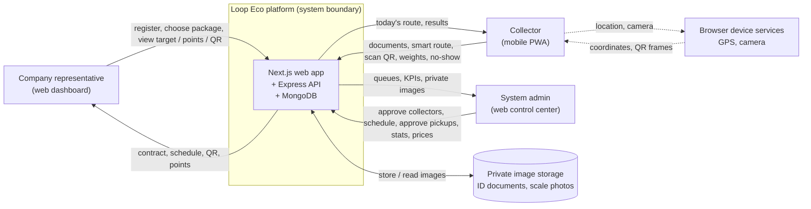

# 01 — Context Diagram

> **Owner:** Seat 1 & Seat 5 · يوضح حدود النظام ومن يتفاعل معه من الخارج.

## الأطراف

| الطرف | بيعمل إيه | بيتواصل عن طريق |
|---|---|---|
| الشركة | تشترك في باقة، تتابع التارجت والنقاط، تعرض QR للمندوب | متصفح (Desktop/Tablet) |
| المندوب | يرفع مستنداته، ينفذ المسار، يمسح QR، يسجل الوزن وعدم الاستجابة | متصفح موبايل (PWA) |
| الأدمن | يعتمد المندوبين والشحنات، يجدول، يراجع الإحصائيات ويعدل الباقات | متصفح (Desktop) |
| تخزين الصور | يحفظ صور البطاقة والفيش والوجه وصور الميزان بأسماء عشوائية | داخلي، مش متاح للعامة |
| خدمات الجهاز | الـ GPS والكاميرا من المتصفح | Geolocation API / MediaDevices |

**لا توجد أي خدمة خارجية مدفوعة** (خرائط أو دفع أو رسائل) في الـ MVP. ده قرار موثق في `adr/ADR-003-free-geo-routing-and-qr.md`.
