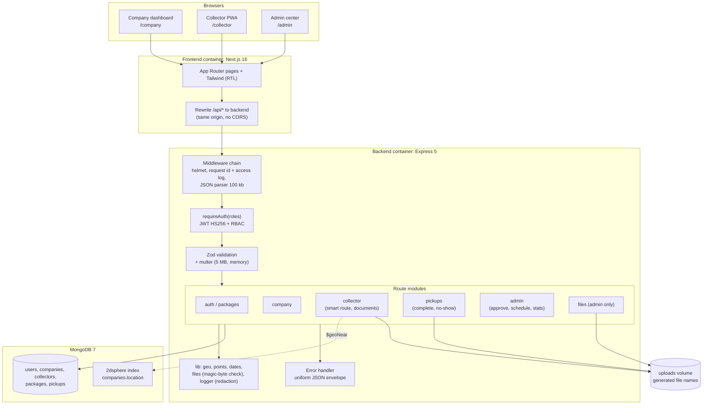

# 02 — System Architecture Diagram

> **Owner:** Seat 5 & Seat 9 · النمط: **Modular Monolith** للـ API + واجهة Next.js واحدة (انظر `adr/ADR-002-architecture-style.md`).

## الطبقات

| الطبقة | المسؤولية | أين |
|---|---|---|
| **Frontend** | الشاشات، حالات Loading/Empty/Error، تخزين الجلسة، تحويل الأخطاء لرسائل عربي | `frontend/app`, `components`, `lib` |
| **API** | قواعد العمل والصلاحيات والتحقق | `backend/src/routes`, `middleware`, `schemas.js` |
| **Domain helpers** | دوال نقية قابلة للاختبار: المسافة، النقاط، التواريخ، فحص الصور | `backend/src/lib` |
| **Data** | collections وفهارس وقيود التفرد | `backend/src/models` |

## قرارات تصميم مهمة

- **نفس الـ origin:** المتصفح يكلم `/api/...` على بورت الواجهة، و Next يحوّل الطلب للـ backend. مفيش CORS ولا عنوان backend في كود المتصفح.
- **شكل رد موحد:** `{ success, requestId, data }` أو `{ success: false, requestId, error: { code, message } }`.
- **الـ Express app مفصول عن الاتصال بقاعدة البيانات** (`app.js` مقابل `server.js`) فاختبارات الأمان تشتغل بدون Mongo.
- **تحديثات الحالة ذرية:** `findOneAndUpdate` بشرط الحالة، فلو ضغط المندوب مرتين أو اعتمد أدمنان في نفس اللحظة، واحد بس ينجح والتاني يأخذ `409`.
- **الوزن الشهري محسوب مش مخزن** (من `approvedMonth`)، فمفيش عدادات تتصفّر أو تتأخر.
