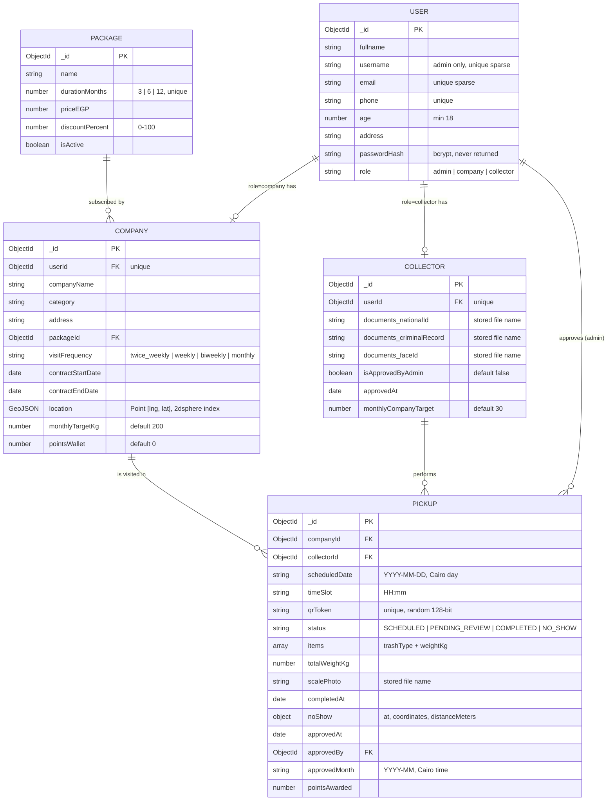

# 03 — ERD / Entity Model

> **Owner:** Seat 5 (Backend Dev 1) · مطابق لـ `backend/src/models/*.js`.

## الفهارس والقيود

| Collection | Index / قيد | الغرض |
|---|---|---|
| `users` | `email` unique sparse · `username` unique sparse · `phone` unique | الدخول بأي واحد منهم، والأدمن مالوش إيميل |
| `users` | `role` مقيدة بـ enum، والتسجيل العام لا يقبل `admin` | منع إنشاء أدمن |
| `companies` | `userId` unique | شركة واحدة لكل مستخدم |
| `companies` | `location` **2dsphere** | `$geoNear` للمسار الذكي |
| `collectors` | `userId` unique | |
| `packages` | `durationMonths` unique (3/6/12) | باقة واحدة لكل مدة |
| `pickups` | `qrToken` unique | كل زيارة لها QR خاص |
| `pickups` | (`companyId`, `scheduledDate`, `timeSlot`) unique | منع حجز نفس الشركة مرتين في نفس الموعد |
| `pickups` | `status`، `approvedMonth`، `companyId`، `collectorId` | استعلامات اللوحات والإحصائيات |

## ملاحظات

- **أنواع الخامات** المسموحة: `plastic` · `paper` · `glass` · `metal`.
- **Migration:** MongoDB مفيهاش schema جدول يتعدل، فالـ migration هنا = `npm run migrate` الذي يتأكد من وجود كل الفهارس (`syncIndexes`) وبيتشغل تلقائيًا قبل الـ seed.
- **الصور** لا تُخزن في قاعدة البيانات؛ فقط أسماء ملفات عشوائية (32 hex + امتداد) داخل volume.
- مفيش `Complaints` collection لأن الشكاوى خارج نطاق الـ MVP (`00-first-user-journey.md`).
