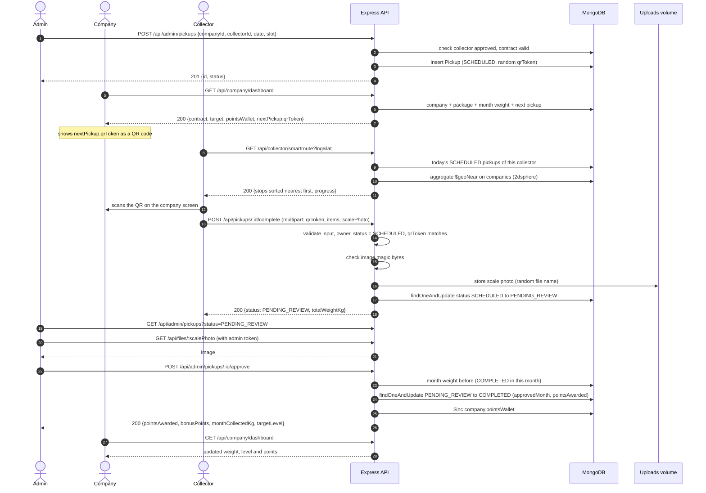

# 04 — Sequence Diagram: الرحلة الأساسية (Success Path)

> **Owner:** Seat 3 & Seat 5 & Seat 7 · يغطي الخطوات 2 إلى 7 من `00-first-user-journey.md`.

## ملاحظات

- الخطوة `validate ... qrToken matches` تحصل **قبل** حفظ الصورة، فمحاولات الفشل ما بتملأش الـ volume.
- الاعتماد بيحسب النقاط من وزن الشهر **قبل** الشحنة، فالمكافأة بتتمنح مرة واحدة فقط (عند عبور التارجت).
- الوزن ما بيدخلش في تارجت الشركة إلا بعد خطوة اعتماد الأدمن.
