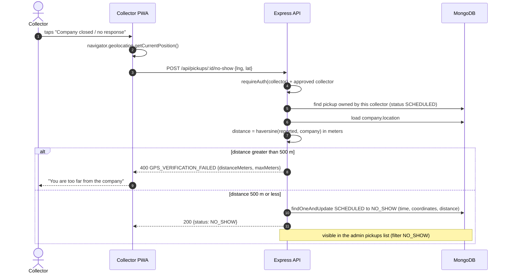
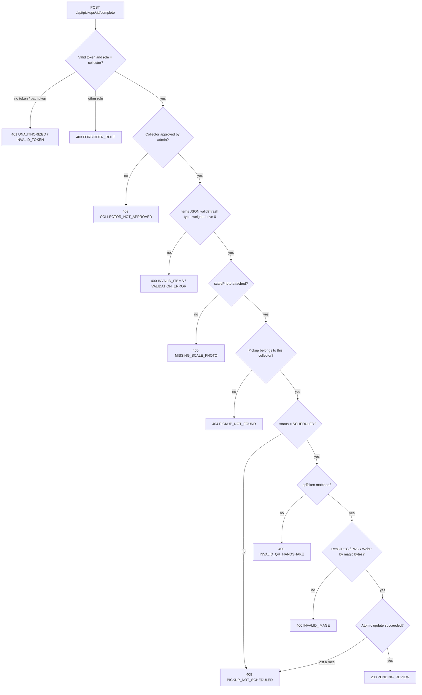

# 05 — Sequence Diagram: حالات الفشل

> **Owner:** Seat 4 & Seat 6 & Seat 8 · يغطي محاولات التلاعب وأخطاء الإدخال.

## أ) "الشركة مغلقة / لا استجابة" والتحقق بالـ GPS

## ب) استلام مرفوض (Negative Cases للـ `complete`)

في كل حالات الرفض: حالة الشحنة تفضل `SCHEDULED` ولا يتغير أي وزن أو نقاط.
