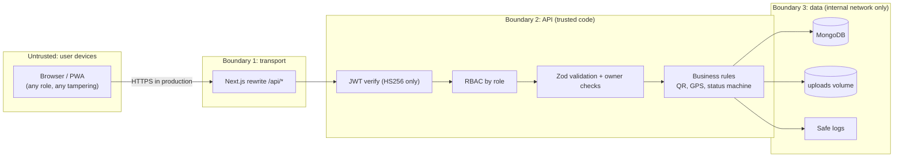

# 07 — Trust Boundaries

> **Owner:** Seat 6 & Seat 8 · مين نثق فيه، فين بنتحقق، وإيه اللي لسه مفتوح.

## 1. ما الذي لا نثق فيه، وكيف نتعامل معه

| الحد | التهديد | الحماية المنفذة | أين / اختبار |
|---|---|---|---|
| **جهاز العميل (Untrusted)** | مندوب يدّعي استلام وهو لم يذهب | الـ QR العشوائي (128 بت) يظهر على شاشة الشركة فقط ويُقارن بزمن ثابت · صورة ميزان إجبارية · الأدمن يراجع الصورة قبل أي نقاط | `routes/pickups.js` · NEG-02 |
| | مندوب يدّعي "الشركة مغلقة" وهو في البيت | السيرفر يقارن الـ GPS بموقع الشركة (≤ 500 م) | `routes/pickups.js` · NEG-04 |
| | تسجيل بحساب `admin` أو إرسال `isApprovedByAdmin: true` | الـ schema لا يقبل `admin`، والحقول الزائدة تُحذف، والـ Controller يبني الـ document حقلًا حقلًا | `schemas.js` · NEG-01 |
| | رفع ملف خبيث على أنه صورة | فحص الـ magic bytes لـ JPEG/PNG/WebP، اسم الملف يولده السيرفر (32 hex)، حد 5 MB | `lib/files.js` |
| **بوابة الـ API** | شركة تقرأ بيانات شركة أخرى | لا يوجد endpoint يقبل `companyId` من الشركة؛ الهوية دايمًا من `sub` في الـ JWT | `routes/company.js` |
| | مندوب يعتمد شحنته أو يلمس شحنة مندوب آخر | `/api/admin/*` للأدمن فقط (`403`)، وزيارات المندوب تُجلب بـ `collectorId` الخاص به (غير ذلك `404`) | NEG-03 · integration |
| | توكن مزوّر أو `alg: none` أو منتهي | `jwt.verify` بـ `algorithms: ['HS256']` فقط | `middleware/auth.js` · `security.test.js` |
| | NoSQL injection (`{"$ne": ""}`) في الدخول أو الـ ids | Zod يقبل strings فقط، والـ ids تُفحص بـ regex قبل أي استعلام | `schemas.js` |
| | تخمين كلمات المرور | rate limit على الدخول والتسجيل، `bcrypt`، ورد موحد `INVALID_CREDENTIALS` مع مقارنة وهمية لو المستخدم غير موجود (لا تسريب لوجود الحساب) | `routes/auth.js` |
| **البيانات واللوجات** | تسريب كلمات المرور أو QR أو أسماء المستندات في اللوجات | لا نسجل body ولا query أبدًا (سطر واحد لكل طلب: method, path, status, ms, requestId)، و`redact()` تخفي أي مفتاح حساس في أي لوج آخر | `lib/logger.js` · `lib.test.js` |
| | الوصول لصور البطاقة والفيش | `GET /api/files/:name` للأدمن فقط، بدون `express.static` عام، مع `Cache-Control: no-store` وحماية من Path Traversal | `routes/files.js` |
| | الوصول المباشر لقاعدة البيانات | داخل شبكة Docker، والبورت منشور على `127.0.0.1` فقط | `docker-compose.yml` |

## 2. قرارات أمنية صريحة

- **الأدمن بالـ seed فقط:** مفيش مسار في الواجهة ولا في الـ API يصنع أدمن.
- **JWT_SECRET إجباري:** السيرفر يرفض التشغيل بدونه (مفيش قيمة افتراضية في الكود).
- **أخطاء الـ 500 لا تسرّب تفاصيل:** الرد عام، والتفاصيل في اللوج فقط مع `requestId`.
- **Helmet** مفعّل على الـ API (`nosniff` وغيره)، وبدون `x-powered-by`.

## 3. حدود معروفة (لم تُحل في الـ MVP)

| الحد | الخطر | الحل المقترح بعد الـ MVP |
|---|---|---|
| الـ JWT محفوظ في `localStorage` | سرقته لو حصلت ثغرة XSS | cookie بـ `HttpOnly; Secure; SameSite` + CSP في Next |
| لا يوجد HTTPS داخل المشروع | كل الأسرار تمر نصًا لو نُشر على HTTP | reverse proxy (Caddy/Nginx) بشهادة TLS في بيئة الإنتاج |
| MongoDB بدون authentication (للتطوير) | أي حاوية في الشبكة تقرأ كل شيء | مستخدم وكلمة مرور و`--auth` في الإنتاج |
| لا يوجد إلغاء للـ JWT (logout سيرفر) | توكن مسروق يظل صالحًا حتى ينتهي (8 ساعات) | مدة أقصر + refresh tokens |
| الـ GPS من المتصفح قابل للتزوير بأدوات المطور | مندوب متقن يستطيع إرسال إحداثيات مزيفة | يُقلل خطره: مراجعة الأدمن، وتسجيل المسافة والوقت لكل بلاغ لكشف الأنماط |
| الـ QR بدون انتهاء صلاحية | من يصوّر الكود يعيد استخدامه | الكود صالح لمرة واحدة فعليًا (الزيارة بعد الاستلام لا تقبله)، وإضافة انتهاء بالوقت تحسين لاحق |
| لا قفل للحساب بعد محاولات فاشلة | تخمين بطيء موزع | قفل مؤقت لكل حساب، بجانب الـ rate limit |
| `TRUST_PROXY=1` (مفعّل في compose) لأن الـ API وراء حاوية الواجهة | لو بورت `5000` متاح للعامة، العميل يقدر يزوّر `X-Forwarded-For` ويتهرب من الـ rate limit | في الإنتاج لا تنشر بورت `5000` للخارج؛ الواجهة فقط (أو reverse proxy) تكلّمه |
