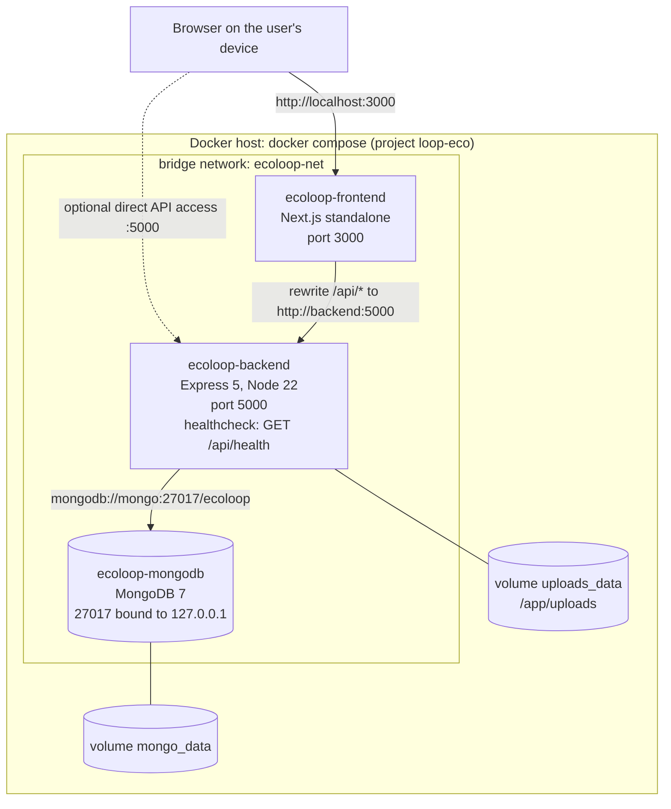

# 08 — Deployment Diagram

> **Owner:** Seat 9 & Seat 10 · مطابق لـ `docker-compose.yml`.

## الحاويات

| الحاوية | الصورة | البورت | ملاحظات |
|---|---|---|---|
| `ecoloop-mongodb` | `mongo:7` | `127.0.0.1:27017` | Healthcheck بـ `mongosh ping`. البيانات في volume `mongo_data`. |
| `ecoloop-backend` | بناء من `backend/Dockerfile` (`node:22-slim`) | `5000` | يبدأ بعد أن تصير Mongo `healthy`. Healthcheck على `/api/health`. المستخدم غير root. |
| `ecoloop-frontend` | بناء متعدد المراحل من `frontend/Dockerfile` | `3000` | يبدأ بعد أن يصير الـ backend `healthy`. |

## المتغيرات (`.env`)

| المتغير | الغرض | افتراضي |
|---|---|---|
| `JWT_SECRET` | توقيع الـ JWT (**إجباري**، compose يرفض البدء بدونه) | — |
| `SEED_PASSWORD` | كلمة مرور حسابات التجربة | `EcoLoop@2026` |
| `APP_TZ` | المنطقة الزمنية لحساب "النهارده" والشهر | `Africa/Cairo` |

## ترتيب البدء ومشاكل متوقعة

1. `mongo` ← `backend` (بعد health) ← `frontend` (بعد health). لو الـ backend فشل في الاتصال بـ Mongo يخرج بكود 1 ويعيد Docker تشغيله.
2. عنوان الـ backend الذي يستخدمه الـ frontend (`BACKEND_URL`) **يُحقن وقت البناء**. لو غيرته: `docker compose build frontend`.
3. الاختبارات داخل الحاوية تستخدم قاعدة `ecoloop_test` (المتغير `MONGO_TEST_URI`)، فلا تمس بيانات التطوير.
